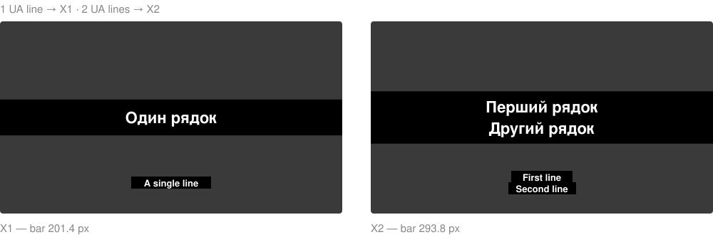

# propresenter-bilingual-songs

Build **bilingual worship song files for ProPresenter 7** (Ukrainian + English on every slide)
from plain lyrics — with [Claude Code](https://claude.com/claude-code) or straight from Python.

[🇺🇦 Українською нижче](#українською)



## What it does

You give the lyrics, you get a ready `.pro` file in your ProPresenter library:

- every slide has the **Ukrainian** text (big, on a black bar) and the **English** text
  (smaller, below);
- slides with **2 lines** get a tall bar (layout **X2**), slides with **1 line** a short bar
  (layout **X1**) — chosen automatically per slide;
- sections become ProPresenter groups (`Verse 1`, `Chorus`, `Bridge`, …) with consistent colors;
- slide previews and live output work right away.

There's no official way to generate ProPresenter 7 files. This project works on the real
binary format: it copies a known-good slide byte-for-byte and changes only the text, IDs
and position, so nothing ProPresenter needs gets lost.

## Requirements

- macOS with **ProPresenter 7**
- **Python 3** (comes with macOS developer tools; no extra packages)
- optional: **Claude Code**, to just say "add this song" in chat
- the look uses the font **Stolzl Medium**; without it ProPresenter substitutes another font

## Option A — use it as a Claude Code skill

1. Copy `skill/new-x2-song/` into your ProPresenter library folder as
   `.claude/skills/new-x2-song/`:

   ```
   ~/Library/Application Support/RenewedVision/ProPresenter/UserWorkspaces/ProPresenter/Libraries/<your library>/.claude/skills/new-x2-song/
   ```

   (Finder hides `.claude`: press **Cmd + Shift + .** to show hidden folders.)
2. Open Claude Code in that library folder.
3. Ask: *"Add a new song: …"* and paste the lyrics, or run `/new-x2-song`.

Claude splits the lyrics into slides, builds the file, checks it, and copies it into the
library — but only after you close ProPresenter (it rewrites files in its library while open).

## Option B — plain Python

Write the song as JSON (see [`examples/example_song.json`](examples/example_song.json)):

```json
{
  "title": "Example Song",
  "groups": [
    {"name": "Verse 1", "slides": [
      {"ua": ["Перший рядок", "Другий рядок"], "en": ["First line", "Second line"]}
    ]},
    {"name": "Chorus", "slides": [
      {"ua": ["Один рядок"], "en": ["A single line"]}
    ]}
  ]
}
```

```bash
python3 skill/new-x2-song/scripts/build_song.py examples/example_song.json "Example Song_x2.pro"
python3 skill/new-x2-song/scripts/inspect_song.py "Example Song_x2.pro"
```

Close ProPresenter, copy the `.pro` file into your library folder, and open ProPresenter again.

## Use your own design

`skill/new-x2-song/templates/` holds two one-slide placeholder songs that define the look
(fonts, colors, positions). Replace them with one-slide songs made in your own ProPresenter
using the same three layers — English text, Ukrainian text, background bar — and new songs
will follow your design. Other language pairs work the same way: the "UA" layer is just
the primary language.

## How it works

See the "How the file works" section of [`SKILL.md`](skill/new-x2-song/SKILL.md) for the
protobuf field map. Two pitfalls we hit, so you don't have to:

- each slide needs its **own base-slide ID**, otherwise ProPresenter shows the same
  preview thumbnail for every slide (live output is still correct, which makes it confusing);
- **close ProPresenter** before writing into its library, or it may overwrite your file.

## Related projects

- [greyshirtguy/ProPresenter7-Proto](https://github.com/greyshirtguy/ProPresenter7-Proto) —
  reverse-engineered `.proto` definitions for ProPresenter 7
- [JacobBaartse/MultiLanuageProPresenter](https://github.com/JacobBaartse/MultiLanuageProPresenter) —
  a Python tool for multi-language ProPresenter imports
- [propresenter7-php-lib](https://git.stadtmission-butzbach.de/public/propresenter7-php-lib) —
  a PHP library for `.pro` files

Not affiliated with or endorsed by Renewed Vision. ProPresenter is their trademark.
Back up your library before trying it.

## Author

**Dmytro Kartinnik** — [dkartinnikdesigner.com](https://dkartinnikdesigner.com/)

## License

[MIT](LICENSE)

---

## Українською

Створюйте **двомовні пісні для ProPresenter 7** (українська + англійська на кожному слайді)
просто з тексту — через [Claude Code](https://claude.com/claude-code) або Python.

### Що вміє

- на кожному слайді **український** текст (великий, на чорній плашці) і **англійський**
  (менший, знизу);
- слайд із **2 рядками** отримує високу плашку (макет **X2**), з **1 рядком** — низьку (**X1**);
- частини пісні стають групами ProPresenter (`Verse 1`, `Chorus`, `Bridge`…) з однаковими кольорами;
- прев'ю слайдів і вивід на екран працюють одразу.

### Потрібно

- macOS і **ProPresenter 7**
- **Python 3** (без додаткових пакетів)
- за бажанням — **Claude Code**
- шрифт **Stolzl Medium** (без нього ProPresenter підставить інший)

### Як користуватися з Claude Code

1. Скопіюйте папку `skill/new-x2-song/` у свою бібліотеку ProPresenter як
   `.claude/skills/new-x2-song/`
   (`~/Library/Application Support/RenewedVision/ProPresenter/UserWorkspaces/ProPresenter/Libraries/<ваша бібліотека>/`).
   Приховані папки у Finder: **Cmd + Shift + .**
2. Відкрийте Claude Code у папці бібліотеки.
3. Напишіть: *«Запиши нову пісню: …»* і вставте текст, або `/new-x2-song`.

Claude розіб'є текст на слайди, збере файл, перевірить його і покладе в бібліотеку —
тільки коли ProPresenter закритий (відкритий ProPresenter може перезаписати файл).

### Без Claude

Опишіть пісню в JSON (приклад — [`examples/example_song.json`](examples/example_song.json)) і запустіть:

```bash
python3 skill/new-x2-song/scripts/build_song.py examples/example_song.json "Example Song_x2.pro"
```

Закрийте ProPresenter, скопіюйте `.pro` у папку бібліотеки, відкрийте ProPresenter.

### Свій дизайн

У `skill/new-x2-song/templates/` лежать два шаблони з одним слайдом-заглушкою. Замініть їх
своїми (три шари: англійський текст, український текст, плашка) — і нові пісні
матимуть ваш вигляд. Інші пари мов теж працюють: шар «UA» — це просто основна мова.

Автор — **Дмитро Картіннік**, [dkartinnikdesigner.com](https://dkartinnikdesigner.com/).

Проєкт не пов'язаний з Renewed Vision. Перед використанням зробіть резервну копію бібліотеки.
